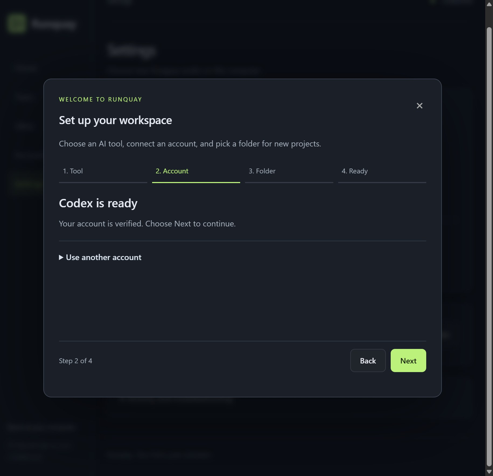

# Start here if you do not know coding

Runquay lets you describe something you want in everyday words, ask an AI coding tool to make it, and find the finished files. You do not need to choose a programming language for a small first project.

**Good first projects:** a personal webpage, a daily checklist, or a simple expense tracker using made-up examples. Start small so you can tell whether the result does what you asked.

Runquay needs a one-time setup. The first-launch setup file can install missing Python/Git using your OS package manager. The dashboard can prepare Codex, Claude Code or Gemini CLI. OS permission prompts and provider sign-in still need you. [Automatic setup details](SETUP.md). Your AI provider may require a subscription or apply charges. Runquay itself is free and open source.

## 1. Prepare your computer

- **Python 3.11 or newer** runs Runquay. Get it from [python.org](https://www.python.org/downloads/). On Windows, select the installer's option to add Python to PATH. PATH is the list of places your computer searches for programs.
- **Git** keeps new project folders organized. Get it from [git-scm.com](https://git-scm.com/downloads). You do not need to learn Git commands for your first task.
- **An AI helper** connects Runquay to your chosen coding service. Having a ChatGPT, Claude or Gemini chat account alone does not install that helper. The [tool setup page](TOOLS.md) links to official installation instructions. Sign in through the provider; never paste passwords or tokens into Runquay.

A **terminal** is an app where you type instructions for your computer. On Windows, use PowerShell; on Mac or Linux, use Terminal. You may need it to install or sign in to the AI helper. After setup, everyday Runquay tasks use the dashboard buttons.

## 2. Open Runquay

Open [the latest release](https://github.com/dibyapp/runquay/releases/latest). On Windows, download and open **Install-Runquay.cmd**. On Mac or Linux, download **install-runquay.sh**, open Terminal in Downloads, and enter `sh install-runquay.sh`. Runquay checks the download and opens setup. Windows adds a Start entry; Mac adds **Runquay.command** in Applications.

If you prefer the source ZIP, extract it first; do not open the launcher while it is still inside the ZIP.

| Computer | What to open |
| --- | --- |
| Windows | Double-click **setup.cmd** in the extracted folder. Windows may display it simply as **start** if filename extensions are hidden. |
| Mac | Open **setup.command** in the extracted folder. Its terminal window starts the local dashboard. |
| Linux / Ubuntu | Open Terminal in the extracted folder and enter **sh setup.sh**, then press Enter. File managers vary, so double-click behavior is not assumed. |

If you prefer a terminal, enter `python runquay.py start` in the extracted folder. Mac/Linux may call Python `python3`. If you need to navigate to the folder, type `cd `, drag the extracted folder into the terminal, then press Enter. `cd` means change folder.

Runquay opens [its dashboard](http://127.0.0.1:8765/) in your browser. This address belongs to your own computer. Keep the launcher window running while the AI works. Closing the browser tab alone does not stop work.

The setup file installs missing essentials for supported package managers; unsupported or restricted systems get an explanation and official installation links. The Windows and Mac launchers keep the error visible. More startup help is in [troubleshooting](TROUBLESHOOTING.md).

## 3. Follow the setup guide

1. **Tool:** Runquay identifies your OS and suggests a tool. Keep that choice or choose another. If software is missing, choose **Install missing tools**, wait for **Tools are ready**, then choose **Next**. The app fills in the connection settings. Installation does not prove sign-in or billing. **Manual setup or troubleshooting** handles OS permission prompts.
2. **Account:** when you see **Codex is ready**, choose **Next**. Runquay has already found and checked your login. If it asks you to connect, choose the detected tool and its **Connect** button; the app chooses an account name. For a separate Codex account, choose **How to sign in → Sign in with Codex** and finish on OpenAI's website in the browser that opens. Runquay checks the connection afterward. **Use terminal instead** is a fallback. Current Codex app logins are reused; sign in through Codex if that login needs refreshing. For other tools, expand **Sign-in instructions**, complete the vendor steps in your terminal, then choose **Check connection**. Other tools verify authentication through a separately approved run. **Use another account** is optional.
3. **Folder:** keep the suggested folder unless you want to change it. A project folder is simply where the files made for one task are stored.
4. **Ready:** read the workspace and billing rules, tick the acknowledgement, and choose **Finish setup**. New installations start paused.

Setup does not purchase a plan or authorize a reset. If a sign-in command reports an error, keep the error text and follow the provider's official instructions rather than pasting passwords into Runquay.

To connect another tool later, open **More → AI connections → Add account**. Choose an installed tool; an existing connection says **Done**, otherwise choose **Connect**. No name or path is required. **Sign in to another account** creates a separate profile. For Codex, choose **Continue to sign in → Sign in with Codex** to start browser sign-in; **Cancel sign-in** stops a pending attempt. Other tools show their terminal instructions. **More options** contains optional names, uninstalled tools and custom setup. Connecting a detected program does not prove its authentication or billing.

## 4. Say what you want

Open **Create**. Type something like:

> Make a daily checklist. Let me add tasks, tick them off and save them in this browser. Make it easy to use on my phone.

Choose **↑**. That’s the everyday flow. You do not have to name a task, choose a programming language, configure a model, or start a queue afterward.

**New project** is selected for you. It creates a separate folder. To improve something you already have, choose its name from that menu before sending. Runquay shows the folder name and AI tool underneath. **Change AI** is optional. One unfinished task can use a folder at a time; open its existing card to continue it.

Sending uses your connected AI allowance. The selected provider receives the request and can access the selected workspace through its coding tool. Other providers ask before each run because their charges are unverified. Codex requires verified subscription allowance and a zero paid balance. Resets need your approval. No purchase or publishing happens automatically.

## 5. Come back to your work

The work appears below your message:

- **Up next:** it will start when the worker and AI are available.
- **Working on it:** follow **See progress**, or come back later.
- **Waiting for your AI:** check sign-in or wait for allowance to refresh.
- **Needs you:** choose **Reply** and answer the question.
- **Ready to try:** choose **↗** on a finished work row.

For a pause, open **More** on that card and choose **Pause**. Files already written remain. **Continue** starts just that task again. To stop everything, expand **Work controls and activity** and choose **Pause work**. Your computer must stay awake, running and connected while work continues; closing the browser alone does not stop it.

## 6. Try the result and ask for changes

Choose **↗** on a finished work row, read the opening instructions and choose **Open project folder**. Try the result yourself. The AI may make mistakes, so check it before relying on it or sharing it.

Choose **··· → Ask for a change** to describe what should be different. Your follow-up starts automatically when the AI is available. If you cannot open the project, choose **Ask for help** in the result window and describe where you got stuck. Work limits stay under an optional control.

## 7. Your earlier conversations

Saved conversations from supported tools appear in the same list, with the tool’s icon and project name. Use **Find your work** to search by name. **View** opens the available local preview. Continue the original conversation in its original tool. If its folder is available, **Work on [project]** selects that folder for a new request; the preview is not silently added to your request.

**Browse all conversations and folders** provides detailed filters, refresh and import when needed. Missing history is not a signal that a conversation was deleted. [History support and limitations](TASK_HISTORY.md).

**Learn** helps find useful lessons across work you choose. **More** contains optional ideas, AI connections and settings. You can keep using the original tools alongside Runquay. [How sessions work](WORKFLOWS.md).
