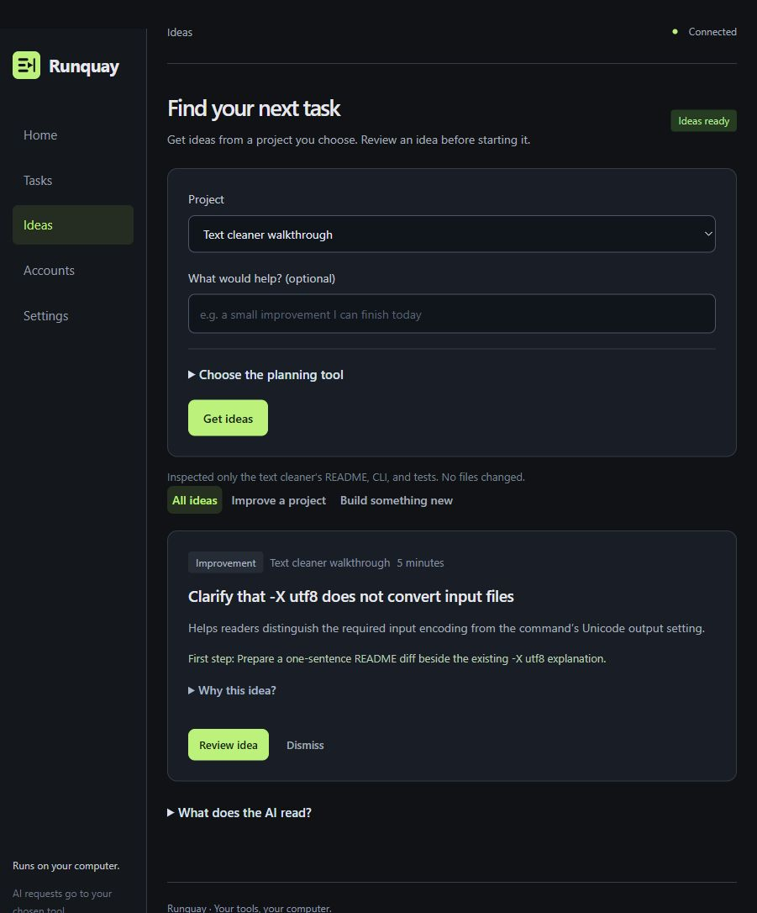

# Getting started with Runquay

**New to coding?** Follow the [beginner guide](BEGINNERS.md) for setup explanations, an idea form and opening your result.

Runquay runs your existing AI coding CLI on your computer. You describe a goal, choose the tool, and let a persistent local queue work through bounded milestones. This guide covers installation, all four onboarding steps, and your first task.

**Start here:** [Install](#1-install-the-prerequisites) · [Onboard](#3-complete-the-four-setup-steps) · [Add a task](#5-add-one-small-task) · [Review the result](#6-start-work-and-review-the-result)

For day-to-day use, read the [workflow guide](WORKFLOWS.md). For problems, use [troubleshooting](TROUBLESHOOTING.md). Check the [verification record](VERIFICATION.md) before assuming an OS or provider has been live-tested.

## 1. Install the prerequisites

You need **Python 3.11 or newer**, **Git**, and a supported vendor CLI with an account you are permitted to use. Runquay itself requires no Python packages. Individual AI tools may require Node, a sandbox runtime, authentication, or a paid subscription of their own.

### Windows

Install Python from [python.org](https://www.python.org/downloads/windows/) and Git from [git-scm.com](https://git-scm.com/downloads). Enable Python's PATH option when the installer offers it. Open a new PowerShell window after installation and check:

```powershell
py -3 --version
git --version
```

If the Python launcher is unavailable, try `python --version`. The version must be at least 3.11. If a command is missing, finish installation and reopen the terminal before continuing.

### macOS

Install a current Python from [python.org](https://www.python.org/downloads/macos/) and Git from [git-scm.com](https://git-scm.com/downloads). In Terminal, check:

```sh
python3 --version
git --version
```

Runquay's deterministic suite runs in macOS CI. That does not establish that vendor authentication, sandboxing or LaunchAgent installation has been manually exercised on your Mac.

### Ubuntu / Debian-based Linux

Install Python and Git through your distribution's package manager. On Ubuntu:

```sh
sudo apt update
sudo apt install python3 git
python3 --version
git --version
```

Confirm Python is 3.11+. Older distribution releases may need a newer supported Python installed through an appropriate source. Other Linux distributions use their own package names and service managers; the guide does not assume every distribution was tested.

### Install an AI coding tool

Use the tool's official installation instructions linked in [TOOLS.md](TOOLS.md). Authenticate through its official CLI or browser sign-in flow. Runquay does not install the vendor tool or take your password.

| Tool | What to expect in Runquay |
| --- | --- |
| Codex | Subscription authentication, verified quota and zero paid balance are required before a milestone starts. |
| Claude Code | CLI detection and adapter contracts are checked; each invocation needs approval because billing is unverified. |
| Gemini CLI | Contract-tested adapter; install and validate the vendor runtime and account on your machine. Each invocation needs approval. |
| Antigravity CLI | Requires the compatible headless `agy` tool. Editor installation alone is insufficient; isolated-home behavior and read-only planning are unverified. |
| Custom CLI | Supply a headless wrapper with the documented JSON result contract. The wrapper owns permissions and authentication. |

## 2. Download and start Runquay

Get the source ZIP from [GitHub Releases](https://github.com/dibyapp/runquay/releases/latest). Extract it into a folder you can write to. Keep the checkout at a stable location if you later enable startup services. Alternatively, clone the current source:

```sh
git clone https://github.com/dibyapp/runquay.git
cd runquay
```

In the extracted or cloned folder, start the launcher.

Windows:

```powershell
py -3 runquay.py start
```

macOS / Linux:

```sh
python3 runquay.py start
```

Windows can also open `start.cmd`; macOS can open `start.command`; macOS/Linux can use `sh start.sh`. The launcher opens [127.0.0.1:8765](http://127.0.0.1:8765/). Keep the terminal running while using a foreground instance. Ctrl+C stops it; closing the browser tab alone does not stop the queue.

If Python is called `python` on your machine, substitute it in these commands. Do not expose the dashboard through a public proxy or tunnel. It is a local, single-user application.

## 3. Complete the four setup steps

The guide opens on a new installation. You can reopen it at **Settings → Open setup guide**. Setup retains existing accounts, projects and the current work start/pause state.

### Step 1 — Tool

Installed tools appear first; expand **Other supported tools** for more adapters. **Installed** confirms executable detection, not account authentication. Use **Installation guide** to find vendor setup instructions. Runquay makes no model request during detection.

Choose the **Tool for project ideas**. Only advisors with an enforced read-only mode are offered. Antigravity and custom tools currently support execution adapters but have no verified read-only advisor.

### Step 2 — Account

When the chosen tool shows **Codex is ready**, choose **Next**: its login is already verified. Otherwise use **Connect account** or its sign-in/check controls. **Use another account** is optional.

The account dialog shows installed tools as buttons. Choose a tool, then **Connect**; names and paths are filled automatically. A current login already connected says **Done**, without creating a duplicate. **Sign in to another account** creates a separate profile and opens sign-in. Codex offers a browser sign-in button; other tools show their vendor instructions. Optional names, other tools and custom commands are under **More options**. Detection confirms installation; it does not prove authentication or billing.

A verified Codex subscription displays **Codex is ready**. For a separate Codex profile, choose **How to sign in → Sign in with Codex**. The official CLI opens ChatGPT browser OAuth and Runquay checks the connection when it completes. **Cancel sign-in** stops an attempt; **Use terminal instead** contains the exact profile command and **Check connection** fallback. Existing shared Codex app credentials are refreshed through Codex itself. Other tools use **Sign-in instructions** in your terminal. Other tools' authentication is established by a separately approved invocation, not detection alone.

There is no application account-count cap. Additional profiles do not increase provider allowances. Never paste passwords, API keys or auth files into Runquay.

### Step 3 — Folder

Choose an absolute writable **New-project folder** on this computer. Each new task creates a separate Git workspace inside it. Existing tasks keep their paths when you change this root.

**Connect a project folder** adds an existing directory without moving or editing its files. Import reads filenames and a bounded README preview. Saved Codex desktop roots are discovered automatically; projects from other tools can be connected by folder.

### Step 4 — Ready

Review workspace access and billing, select **I understand the workspace access and billing rules**, then **Finish setup**. First installations stay paused. This acknowledgement does not authorize a reset, a paid tool run or a purchase.

## 4. Describe what you want

Open **Your work**, describe your request in everyday words and choose **Let’s do it**. A new project folder is selected by default. Choose a saved project from the menu only when you want its files changed. The AI tool is shown underneath; **Change AI** is optional.

This starts only your request when an account is available. It does not enable unrelated work in a paused queue. Existing global queue controls remain under **Work controls and activity** for users who want them.

## 5. Follow progress

Your request appears below the composer alongside saved conversations. It says **Up next**, **Working on it**, **Waiting for your AI**, **Needs you**, or **Ready to try**. Use **See progress** to follow a running request. Choose **Reply** when the AI needs input. Use the card’s **More → Pause** to pause it, and **Continue** to resume just that request.

Codex needs verified subscription quota and zero paid balance. Other providers ask for approval before each invocation because billing is unverified. Requests appear above your work. Waiting or declining remains available. Runquay never purchases credits or resets. **Work controls and activity → Pause work** also disarms individually started requests and stops active child work; written files remain.

## 6. Try the result

Choose **View result** for opening instructions and **Open project folder**. The handoff reads START_HERE.md, with README fallback, and does not execute files. Check the result yourself before accepting or publishing it. Choose **Ask for a change** for a follow-up, or **Ask for help** if you cannot open it. Sending a follow-up starts that request when its AI is available.

[Beginner walkthrough](BEGINNERS.md) · [Daily workflows and detailed controls](WORKFLOWS.md)

## 7. Find your next task

Open **More → Find ideas**, choose a project and optionally enter a focus. Select **Get ideas**. If work is paused, choose **Start work to get ideas**. The selected project also filters saved proposals; **All my projects** includes new-project ideas.



Open **Why this idea?** to inspect evidence, then **Review idea** to edit the goal and choose the execution tool. A suggestion alone never starts a build. Requested planning sends relevant context to the selected provider. Change providers under **Choose the planning tool**.

## Next steps

- [Workflow guide](WORKFLOWS.md): existing repositories, AI suggestions, approvals, recovery and continuous use.
- [Troubleshooting](TROUBLESHOOTING.md): detection, quota, execution, state and startup issues.
- [Tool setup](TOOLS.md): adapter authentication, output contracts and verification boundaries.
- [Operations](OPERATIONS.md): data locations, backups, per-user startup and shutdown.
- [Security](../SECURITY.md): the local trust boundary and safe reporting.


## Automatic setup

For a fresh computer, use **setup.cmd**, **setup.command** or **sh setup.sh** instead of manually preparing every dependency. The dashboard detects the OS, recommends an installed tool, lists missing software and offers **Install missing tools**. A new connection is created automatically on Next; sign-in remains with the vendor. [Full setup and permission guide](SETUP.md).

## Find tasks you already have in Codex

The detailed **Your work → Browse all conversations and folders → Existing AI tasks** view combines Codex, Claude Code, Gemini CLI and available Antigravity local histories. Choose an **AI tool**, search for a title or project, then open **Task summary**. **Refresh tasks** checks again without starting AI work. Other tools can use **Import history** with a compatible metadata JSON file.

The local queue belongs to this Runquay installation. A saved conversation is separate from that queue; open its original tool to continue it. Missing folders, older encrypted history and unsupported cloud exports are explained rather than guessed. [Detailed guide, supported sources and import example](TASK_HISTORY.md).


## Reuse what you learned

Open **Learnings** to collect lessons from work across projects and AI tools. Ask about any topic or choose a suggestion. Runquay finds matching work and an
analysis tool. Review the context and choose Analyze; lessons appear automatically
without starting unrelated paused tasks. Use a useful lesson in a task with one action. [Collective Learnings walkthrough](COLLECTIVE_LEARNINGS.md).
