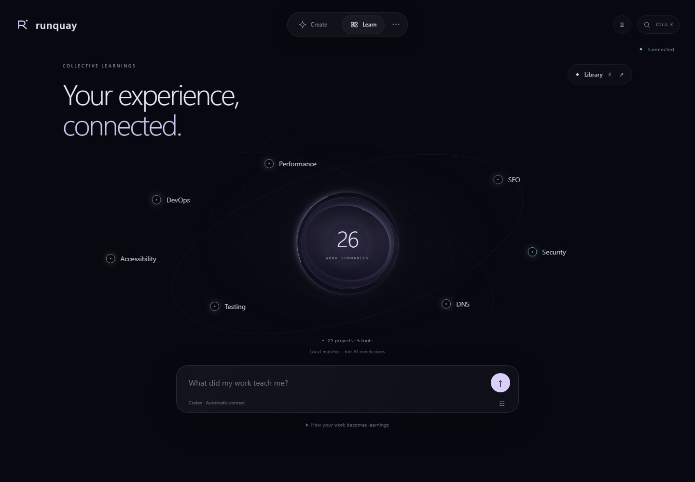

# Runquay Field

The app opens into **Create** and **Learn**, reached from the floating dock.

In **Create**, write what you want and send it with **↑**. The selected project and AI stay visible. Click the project name to search saved folders or choose **New project**. Use the arrow keys and Enter to select, or Escape to close. Four recent work rows sit underneath; **↗** opens progress, a result or a saved preview, depending on its row. **All your work** opens the full searchable stream. **···** contains pause and other task actions. Your original vendor conversations still continue in their own tools.

In **Learn**, topics sit around a knowledge field. They are keyword matches from local summaries, not AI conclusions or a semantic relationship graph. The center shows available source summaries, not generated lessons. Choose a topic or ask a question. Review the exact context before **Analyze** sends anything to a provider. **Library** opens your lessons; choose one to read its explanation, caveats and evidence. **Use this** keeps the lesson and attaches it visibly to the message composer. Remove the attachment with **×** before sending if you do not want it included.

**Ctrl K** on Windows/Linux or **⌘ K** on Mac opens command search. Type a project, conversation or lesson title, or jump to a page. Use ↑/↓ and Enter, or click a result. Search is local and does not invoke a model or search raw logs.

**Ⅱ** pauses ambient animation on larger screens. The app also follows your system’s reduced-motion setting. Topic hit targets stay stationary while their light animates. Canvas frames stop when Learnings is not visible or the tab is hidden. The visual field works without animation; it does not claim AI is working unless an analysis is actually running.

A **Your decision is needed** control appears on every page when a billing or reset decision is waiting. Closing it keeps work waiting. Nothing is purchased or reset automatically. One-time setup and vendor sign-in still need you. [Billing and tool support](TOOLS.md).

These are browser captures of the actual app with fictional history. They are not generated images or evidence of live model performance. [Screenshot provenance](SCREENSHOTS.md).
